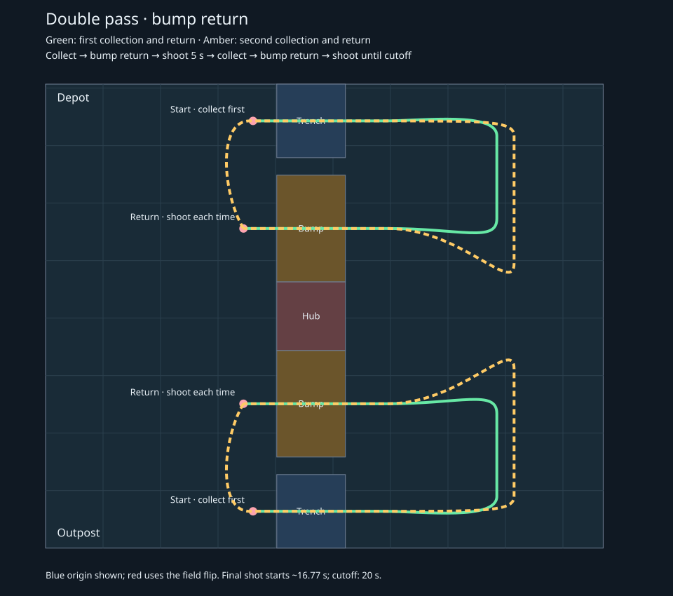

# Double-pass bump-return autos

Select **Outpost Double Pass Bump Return** or **Depot Double Pass Bump Return**
in **Auto Path**. These are new variants of the existing collect-return autos.
Depot mirrors Outpost across the field width; red uses the existing alliance flip.



Both variants leave immediately while deploying the intake and spinning up.
They keep the preloaded balls during the first collection, return and stop for
a 5-second shot of preloads plus collected balls, then collect again, return over
the bump again, and request another 5-second shot. The second shot is interrupted
by the 20-second deadline if time runs out. There is no initial preload shot or startup wait.
The first pass leaves through
the trench and returns over the adjacent bump. The second departure moves back
to the trench lane before crossing into neutral territory. Both paths return
over the bump to the same stopped shooting pose; neither stops in midfield.

| Blue starting center, heading 0° | Outpost | Depot |
| --- | --- | --- |
| Starting pose (m) | (3.6091, 0.6393) | (3.6091, 7.4297) |
| Both return shooting poses (m) | (3.4428, 2.5105) | (3.4428, 5.5585) |

Place the initial front bumper **on the starting line**. The hood-clearance
logic uses the actual oriented bumper footprint while stationary. Movement or rotation enables the
conservative approach buffer and retraction lookahead again.

Bump crossing is limited to 1.5 m/s with 1.5 m/s² acceleration, and pickup keeps
the existing 1.48 m/s (40%) speed limit. These limits cover the actual bump
crossing and pickup sections, with small buffers at intake events. Outside
those sections, transit uses 3.7 m/s and the model's 11.76 m/s² traction ceiling;
PathPlanner's motor, gearing, 60 A current, traction, module-speed, and cornering
limits determine the achievable acceleration and braking. There is no extra
3 m/s or 8 m/s² transit cap. Validate these modeled limits on the robot.

The second departure now curves smoothly into the trench lane rather than
making a sharp corner. Bezier handles, transit anchors, the return shooting X,
and the bump-zone boundaries were searched against the configured dynamics.
Both pickup sweeps retain their original anchors and coverage. The second
pickup transitions directly into its return curve without stopping at the end
of the sweep. The intake stops before each return, and the flywheel stays spun
up through both trips.

| Modeled timing | Collect first |
| --- | --- |
| First collection and return / first shot begins | 5.18 s |
| Five-second return shot complete / second departure | 10.18 s |
| Second intake begins | 12.53 s |
| Second bump return complete / final shot begins | 16.77 s |
| Time available for final shot before cutoff | 3.23 s |
| Full routine if the final shot were allowed all 5 seconds | 21.77 s |

The optimized paths cover about 24.37 m. Command-sequence tests at 20 ms confirm
both full paths and the first five-second return shot complete before the cutoff,
then the second shot runs until the deadline stops the drive, intake, and flywheel.
These timings exclude command transition overhead and must be validated on the robot.

The search evaluated 1,379 candidates across six deterministic starting seeds.
This is the best result found within the searched route family, not a proof of
a global optimum. The [optimization report](double-pass-optimization.json)
records the model limits, winning parameters, distance, and timings.

```sh
./gradlew simulateJava '-Pauto=Outpost Double Pass Bump Return'
./gradlew simulateJava '-Pauto=Depot Double Pass Bump Return'
./gradlew optimizeDoublePass
```

Trajectory tests check both sides, stopped path connections, bumper clearance,
trench outbound and bump inbound crossings, pickup and bump speed limits,
shooting-pose hood clearance, preserved shooting commands, and the deadline budget.
They also check continuous tangents at interior waypoints, use of the available
transit speed, completion of both sweeps and returns in the actual command
sequence, and cleanup when interrupted during either pickup, the second return,
or the final shot.
